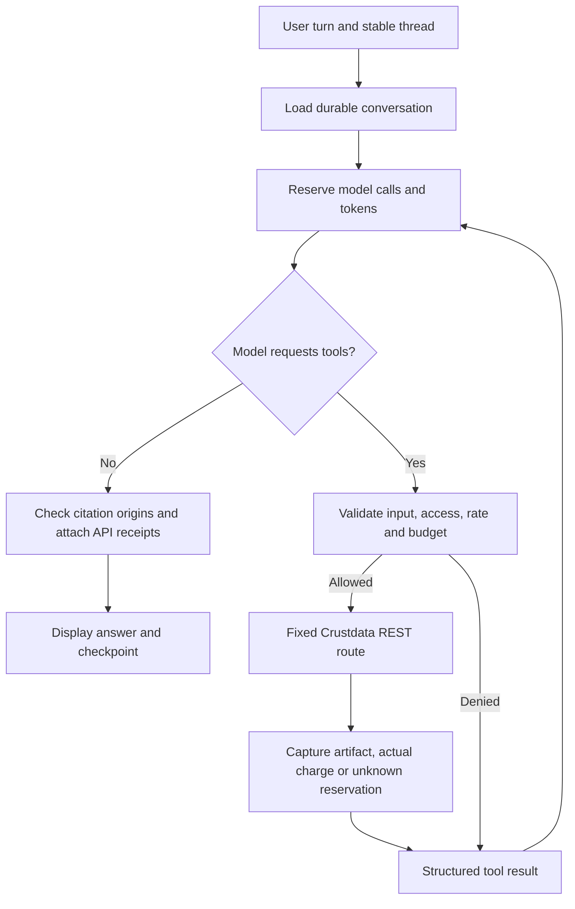

# Technical Vendor Evidence Review

Idea C: a local Python **LangGraph** agent with guided buyer intake, a requirement/claim map, preliminary vendor-document research, and a standalone HTML evidence dossier. Typed Crustdata REST tools, visible operations, persistent conversations and a durable cost ledger bound the work. Read-only customer corroboration and professional (role/post) research branches are implemented; their live validation is incomplete (see [corroboration validation](docs/build/CORROBORATION_VALIDATION.md)). Full semantic evidence review remains a subsequent stage. Their requirements remain authoritative in [PRODUCT](docs/build/PRODUCT.md) and [WORKFLOW](docs/build/WORKFLOW.md).

## Intake → vendor research → HTML dossier

The canonical regression scenario is now **[project44](benchmarks/project44/README.md)**. Its versioned brief (current v1.1.0, branches enabled; frozen v1.0.0 via `--benchmark-version 1.0.0`) preserves the original questions/checks; historical reviewer findings stay in a separate file and are not supplied to the research agent. Confirm scope with `vendor-review --benchmark project44 --confirm-only`, or begin intake with `vendor-review --benchmark project44 --thread project44-benchmark`. Scope acknowledgement is not a research pass.

Chat normally with `vendor-review --thread BUYER_NAME`. The default is now the research workflow. It records the vendor/domain, buyer purpose, requirements, priority, measurable acceptance criteria and constraints for geography, integrations, scale, security, budget and timeline. Missing information triggers targeted questions and blocks paid research. Explicit unknowns/not-applicable answers are retained; it does not invent a buyer's constraints. Literal buyer quotes/values anchor the brief. Completeness and requirement-specificity scores describe intake quality, **not vendor suitability**.

After intake, the graph resolves the exact vendor domain and researches relevant product/developer/API, integration, engineering, release and security documents. It can search, follow captured document links, fetch more material and refine findings within the budget. Search snippets do not qualify as supporting evidence. Recorded passages must match captured vendor-owned pages; wrong-domain, challenge and empty pages are rejected. Repeated copies cannot establish conflicting documents. These checks establish passage origin; claim interpretation remains preliminary and does not establish independent verification.

The HTML is human-readable by default: a concise finding, plain-language evidence status, uncertainty and next actions. Exact passages, original buyer wording, extra verification steps and the technical source/cost ledger expand on demand. Follow-up chat should explain the saved passage and its limits, and distinguish further research from an answer already established by the source.

Each turn exports an immutable HTML/JSON snapshot under `.local/reports/THREAD/` plus `latest.html`. The report includes all requirements, including unresearched ones, claim mapping, status, exact passages/URLs/artifacts, retrieval dates, limitations, verification steps, source hashes, coverage and costs. Statuses are `vendor_documented`, `partially_supported`, `conflicting_vendor_docs`, `cannot_verify`, and the attributed `customer_reported`, `professional_attributed`, `third_party_reported` and `conflicting_evidence`. Customer/professional/third-party findings are stored beside, never over, the vendor-document finding for the same requirement. **Independently verified remains No**. Proposed pilot steps are recommendations, not executed tests. Changing the brief invalidates existing findings/identity; prior HTML snapshots remain available.

Use `/report` during chat, or export after restarting **without network/model calls**:

```powershell
.\.venv\Scripts\vendor-review --thread BUYER_NAME --report
```

`--chat-only` explicitly selects the previous foundation chat without intake gating. Reports remain local; nothing is published. View the generated HTML file in your browser. The browser automation policy in this environment blocked local-file preview; structural and escaping tests passed, but visual browser QA is not claimed. See [research validation](docs/build/RESEARCH_VALIDATION.md).

The intended buyer is a technical/procurement team comparing vendor claims against its requirements. This foundation accepts conversational questions about a company and returns bounded provider evidence with URLs or API artifact provenance. A completed lookup does **not** constitute vendor approval, security certification, an independently corroborated deployment or a full assessment.

## Web chat and company discovery

`vendor-review-web` serves a local chat UI (http://127.0.0.1:8765, or set `WEB_PORT`). The intake asks follow-up questions, the brief panel shows the target requirements, and "Start vendor search" needs explicit approval. Set `DISCOVERY=vendor_review.discovery:CrustdataDiscovery` for live discovery:
- A short product query from the brief.
- Free size and age filters, using size labels read from Crustdata autocomplete.
- A ranked `/company/search` pool (`DISCOVERY_POOL`, default 12), reranked locally to the top 4.

The discovery-fit score is a shortlist heuristic, not evidence. V1 evaluation is not yet connected in the web flow. See [discovery validation](docs/build/DISCOVERY_VALIDATION.md).

## Setup

Tested on Windows with Python 3.14.6. Python 3.11+ is declared; other versions/platforms have not been exercised here.

```powershell
cd Z:\Projects\context-con
python -m venv .venv
.\.venv\Scripts\python -m pip install -r requirements.lock
.\.venv\Scripts\python -m pip install --no-deps --no-build-isolation -e .
Copy-Item .env.example .env
```

Edit `.env` locally: supply `CRUSTDATA_API_KEY`, choose `MODEL_PROVIDER` and `MODEL_NAME`, and configure the provider. Never commit `.env`. Environment variables override it. The implementation session's supplied credentials are already in an ignored local `.env`; do not overwrite that file when using the existing workspace.

If Windows sandbox temp paths contain braces and setuptools reports `invalid variable`, set a simple workspace temp directory before the editable install:

```powershell
New-Item -ItemType Directory -Force .local/tmp | Out-Null
$env:TEMP = "$PWD\.local\tmp"
$env:TMP = $env:TEMP
```

Gemini is the primary provider and uses `GEMINI_API_KEY`. The tested default is **`gemini-3.1-flash-lite` on the Free Tier**; `gemini-3.8-flash` is the other currently allowlisted free-tier option. Paid-only models and positive paid Gemini rates are rejected by configuration, and there is no automatic model/provider fallback. Use a Free Tier project/key: the API has no request flag that guarantees free billing if the key belongs to a paid project. Listing a model does not prove generation quota. The application does not create accounts, link billing or buy credits. See [Google pricing](https://aistudio.google.com/docs/pricing), [billing tiers](https://aistudio.google.com/docs/billing), and actual checks in [VALIDATION](docs/build/VALIDATION.md).

For an installed Ollama model, set these in `.env` or the shell:

```powershell
$env:MODEL_PROVIDER = 'ollama'
$env:MODEL_NAME = 'your-installed-tool-capable-model'
$env:OLLAMA_BASE_URL = 'http://localhost:11434'
$env:OLLAMA_TOOL_MODE = 'structured'
```

Start Ollama separately if necessary (`ollama serve`). The application never downloads a model. Local inference is an **optional fallback**, not the research-quality baseline. `structured` mode requests a JSON-schema decision and converts validated model actions into graph tool calls; `native` mode uses Ollama's native tool-call parser. Both go through the same strict executor. An advertised `tools` capability alone does not establish reliable execution. The local adapter currently uses a 16K context setting, and small local models must not be relied on for the later evidence graph; see the observed limitations in the validation report.

## Run and resume

```powershell
.\.venv\Scripts\vendor-review --thread buyer-demo
```

Begin with your vendor and buyer use case; the agent asks for missing requirements and constraints. For the older foundation lookup alone, add `--chat-only`. Follow up in the same chat. Exit with `/exit` or Ctrl+C; restart with the **same command and thread name** to retain history and cumulative allowance.

Commands: `/history`, `/ledger`, `/report`, `/new another-buyer`, `/exit`. A new thread has separate messages and its own explicitly configured allowance; it does not provide an application-wide spending ceiling. One process owns a runtime directory at a time. Keep the same `DATA_DIR` to preserve history, rate windows and budgets. Deleting it removes the local accounting boundary.

Scripted turns use the same graph and real providers:

```powershell
.\.venv\Scripts\vendor-review --thread buyer-demo --prompt 'Identify crustdata.com with a tool.' --prompt 'Which company are we discussing? Use prior results without tools.'
.\.venv\Scripts\vendor-review --thread buyer-demo --prompt 'Continue from our previous conversation without tools.'
```

Diagnostics:

```powershell
# Free account preflight; no model call.
.\.venv\Scripts\vendor-review --thread smoke --check-access
# Opt-in paid REST validation, under the same durable session cap (default 10 credits).
# Exercises identify, selected basic enrichment, one search page and one page fetch.
.\.venv\Scripts\vendor-review --thread smoke --smoke
# Local inspection, without network or a model key:
.\.venv\Scripts\vendor-review --thread smoke --ledger
.\.venv\Scripts\vendor-review --artifact ARTIFACT_ID
```

`--smoke` proves REST adapter behavior only. A successful model-driven tool call and conversational continuity require separate live checks. Mocked tests prove neither. Batch prompt execution exits nonzero on a model failure or budget stop.

## Tools, budgets and storage

Only these fixed read-only routes are available. The model cannot supply an endpoint, token, raw request body, pagination count or premium enrichment group.

| Tool | Boundary |
| --- | --- |
| `account_access`, `account_credits` | Free, version-pinned account metadata; automatic preflight before paid use |
| `identify_company` | One name/domain; ambiguous candidates retained |
| `enrich_company` | One selected `crustdata_company_id`; basic/headcount/funding/locations/taxonomy allowlist |
| `web_search` | One page, explicit web or news source; snippets are leads |
| `fetch_page` | One public URL, provider fetch; bounded capture and extracted excerpt |

[CONTRACTS](docs/build/CONTRACTS.md) links the official request, response, pricing and header sources. Effective account grants and prices govern dispatch. A missing price blocks dispatch. Enrichment uses a selected company ID to avoid ambiguous names producing an unbounded record count. No retries are automatic, including 429s and schema failures. The next turn may retry a transient failure after reviewing its outcome; a timeout must not be treated as proof of no charge.

Default session cap: **10 Crustdata credits**, 40 tool operations, 30 model calls and 100,000 model tokens. Each turn allows **5 Crustdata credits**, 10 tool operations, 10 model calls and 120 seconds. Each model output is capped at 2,048 tokens; requests are capped at 30 seconds. Environment settings allow lowering limits. Session limits are durable and only decrease when resuming a thread: increasing an environment value cannot silently replenish it. Tool requests within one model response are checked separately and execute sequentially. Free preflight calls count toward session tool operations. This workspace's ignored `.env` allows 60-second requests and 180-second turns for initial live validation; the example defaults remain smaller.

Before dispatch the ledger atomically reserves credits/tokens. Returned `X-Credits-Used` is the actual charge; absent/uncertain charges retain the reservation. Charged unusable evidence still costs credits. Model usage and configured token prices are recorded separately; monetary amounts remain **unpriced** without authoritative configured rates. No conversion from Crustdata credits to money is assumed. Local hardware/electricity costs are unpriced.

The ignored `.local/runtime/` contains `checkpoints.sqlite` (LangGraph messages/state), `ledger.sqlite` (operations, raw redacted artifacts, charges, model usage) and an OS-released writer lock. Tool results include operation/artifact IDs and provider timestamps; captures are outside model context. LangSmith tracing is disabled. Tool activity is printed as calls start/finish/are denied, with actual charges and remaining allowance.



After an interrupted process, pending graph work is abandoned with an explicit checkpoint notice, never automatically reissued. Completed call keys reuse recorded results; pending/unknown keys retain reservations. This is not a provider exactly-once or cancellation guarantee. A timed-out model request can still finish at the provider; late tool calls are discarded. Use the ledger/provider request IDs to investigate uncertain outcomes. Pending operations are inspectable even if interruption happened before capture.

## Evidence boundaries

Search snippets are discovery leads. Fetch excerpts identify truncation, possible login/challenge pages, returned-host differences, incomplete HTML and content hashes. Crustdata fetch does not expose a separately verified final redirect URL in this contract; relevance and origin still require review. Raw competing captures remain available. Final responses attach actual API artifact receipts; generated citation URLs absent from retrieved tool data are rejected and replaced by a captured-evidence fallback. This checks citation origin, not whether every claim follows semantically from a source. Passages are checked against fetched excerpts and against focused re-reads of the saved raw capture. Page extraction drops consent/navigation overlays (by element id/class/aria-label, never body wording) and prefers an `<article>`/`<main>` region; `read_evidence(focus=...)` returns every exact focus window. A match found only inside removed consent markup is reported for review but is not citable.

## Customer and professional branches

Read-only. No contact data, reactor/commenter lists, outreach, buying-intent inference or watches.

- **Customer:** a reference needs the customer's own resolved company domain. Corroboration requires one customer-owned passage that itself names the vendor; ownership and vendor mention in different citations do not combine. Each source is labelled customer-, vendor- or other-published. Relationship is direct or indirect (integrator, partner, downstream beneficiary, supplier); indirect references are reported but cannot make the branch sufficient. A historical account never establishes a current contract, transfer to another product or a direct relationship through an intermediary.
- **Professional:** indexed profile identity must match the cited name; authorship is recorded per source (indexed original post by the same person ID, a captured byline needing review, a repost or another author). Findings may cite only that reference's authored sources. Event dates must be explicit in the source; the role timeline reports consistent, outside, date-unknown or freshness-uncertain, never assumes the current title held at the event.
- **Coverage:** both branches record actual operation IDs, references, rationale and gaps; sufficiency needs every listed requirement covered by usable branch evidence, not a fixed source/person count. Any enforced stop (credits, calls, deadline or a model token overrun) marks unfinished branches blocked with the stop reason and gaps, and the report says research stopped.

This is not a final semantic evidence-quality review graph or comprehensive origin deduplication; it must not claim those gates have passed.

The model sees bounded whole recent turns; full history remains persisted. Long prior context may fall outside that window, in which case the assistant must ask for missing context. Provider content cannot change executable permissions or budgets. Grounding instructions are enforced by the system prompt and qualified evidence envelopes; automatic claim-to-source verification is future work, not a guarantee of the foundation.

## Verification and layout

```powershell
.\.venv\Scripts\python -m pytest -q
.\.venv\Scripts\python -m ruff check src tests
.\.venv\Scripts\python -m ruff format --check src tests
.\.venv\Scripts\python -m pip check
```

`src/vendor_review/` separates configuration/redaction, typed schemas, REST operations, evidence compaction, durable accounting, provider construction, graph control and the CLI. Tests use explicit synthetic fixtures and the real LangGraph/SQLite machinery. See [VALIDATION](docs/build/VALIDATION.md) and [CORROBORATION_VALIDATION](docs/build/CORROBORATION_VALIDATION.md) for actual results and live costs.

The build pack and supporting research were copied from `Z:\Projects\AI-Agent` to preserve product intent. Historical probes remain in that original folder under `output/probes/`; their old relative links refer to those original artifacts, which have not been copied into Git or treated as live implementation proof. All application changes are in **context-con**. No implementation commit or remote push is made in this task, per the user's instruction.
