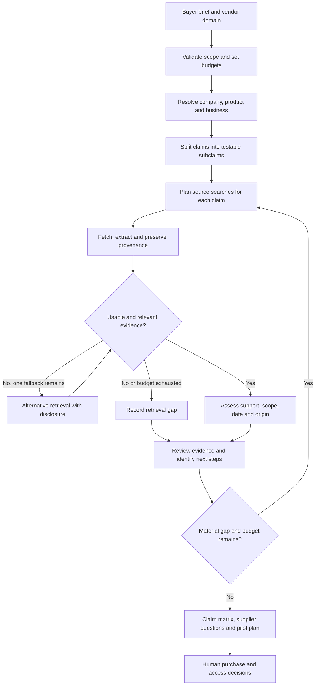

# Idea C: architecture grounded in two retrieval probes

**Current refined specification:** [IDEA_C_FINAL.md](IDEA_C_FINAL.md) includes the selected idea statement, customer discovery/corroboration, targeted professional research, complete workflow and architecture. Use that document as the current design; this earlier architecture remains background on probe findings and implementation controls.

Design review **2026-11-22**. This document is a proposal informed by the [FarEye probe](../output/probes/fareye-20261122/REVIEWED_FINDINGS.md) and the [assistant-reviewed project44 probe](../output/probes/project44-20261122/REVIEWED_FINDINGS.md). It is not an implemented autonomous system or a validated commercial product.

## Job and finished deliverable

**Proposed job:** help a logistics buyer determine which supplier claims have usable evidence, what affects integration and buyer fit, and what to request/test before a purchase. Start with one named vendor and up to five claims.

**Deliverable:** a claim matrix with dated supporting/limiting evidence; integration constraints; unresolved questions ordered by decision impact; and a conditional pilot plan. The output must distinguish documented behavior, historical customer testimony, commercial partner testimony, observed execution and unavailable evidence. Never turn a public screen into supplier approval, security clearance or an accusation of deception.

Buyer requirements are mandatory for a fit recommendation: buyer type, required product/use case, geography, modes/carrier lanes, integrations, data restrictions and acceptance criteria. If unavailable, declare a scenario and provide research questions; do not invent a purchase specification.

## What the probes changed

| Observation | Required design consequence |
| --- | --- |
| Company descriptions repeated marketing material. | Identity/enrichment is context. Track the original publisher; aggregation is not independent confirmation. |
| Broad search returned unrelated or opaque redirect results. | Check entity, destination domain and page content. Search snippets are discovery leads. |
| Connector HTML repeatedly exceeded a 100,000-byte exposed-result cap. | Detect truncation before reasoning. Extract outside the model and allow a disclosed retrieval fallback. |
| Direct HTTP returned recruiting content for customer-article URLs while the page reader exposed historical articles. | Store each retrieval version separately; compare final URL/title/body; mark conflicts and uncertain freshness. HTTP 200 is insufficient. |
| Customer-owned pages supported narrower historical deployment claims. | Match the exact product, role, geography and time. Customer testimony does not validate all vendor outcomes. |
| Legal disclosures and release notes added technical dependencies and dates. | Search source types by the claim's evidence needs, including docs/legal/status/changelog, rather than crawling only marketing pages. |
| A newer update changed the project's relevant buyer/product route. | Resolve brand, business, product/SKU and source date before applying older evidence. |
| The small local model generated unsupported details and a quote validator caught only part of the problem. | Use bounded passages and a semantic review step. Quote validity alone is not entailment or truth. A stronger model still needs these controls. |

Specific source-backed findings, URLs and caveats are in the linked probe reports. These design consequences are our inferences, not vendor capabilities.

## Recommended first implementation

Use **one capable research/review model with a persistent state machine and narrow tools**. MCP or direct REST can supply the data. Keep orchestration independent from provider access. A second review pass can use the same model in a fresh context; it is a consistency challenge, not independent human verification. Start without autonomous agent teams or a new framework.

Persist state after every completed source operation and reviewed claim. Keep raw captures out of the reasoning context; supply a small set of claim-specific passages and source metadata. A long-context model does not remove the need to extract relevant evidence.

## Source acquisition policy

| Need | First source | Follow-up that can strengthen it | Limit |
| --- | --- | --- | --- |
| Correct company and domain | Crustdata identify; narrow enrichment | Vendor corporate/legal pages and recent business changes | Identity confidence does not prove claim accuracy. |
| Integration exists and has a usable contract | Vendor developer docs/OpenAPI, version/deprecation notes | Integrator-owned configuration guide; authorized sandbox later | Documentation is not a successful runtime test. |
| Customer adopted a product | Named-customer domain, technical/news pages | Current reference or independently attributable deployment material | A logo, hosted vendor deck or event appearance is insufficient. |
| Infrastructure/dependencies | Engineering docs, subprocessors, status components | Technology-provider case study tied to the vendor | A commercial case study is not an audit; old stacks may change. |
| AI workflow exists | Product docs plus dated releases | Authorized execution traces and failure/approval demonstrations later | Agent count and model names do not establish quality or safety. |
| Performance or savings | Published methodology and exact metric/cohort | Comparable customer evidence; buyer pilot with baseline later | A percentage cannot be generalized across workloads. |
| Security assurance | Trust center and public scope information | Underlying certificate/report, validity/scope and exceptions | Badges and cloud-provider certifications do not clear the application. |
| Team capability, if actually claimed | Selected professional/company data | Relevant public engineering work | Profiles are incomplete; no hiring signal does not disprove capability. |

For five claims, reuse shared sources rather than searching each claim independently. Before retrieving a page, record which unresolved decision it could change. Stop broad research when additional pages repeat the same origin or cannot change the next step.

Use targeted customer-domain queries after extracting candidate customer names. Model the relationship explicitly: vendor -> direct customer, carrier/integrator, downstream beneficiary or partner. The project44/Girteka/Asendia example must not become a fabricated direct commercial relationship between project44 and Asendia.

## Internal records and evidence rules

The following are **proposed internal records**, not verified Crustdata API schemas:

- `Run`: buyer brief, company/product identity, unresolved assumptions, state, deadline, credit/tool/token budgets and actual usage.
- `Claim`: original wording/URL, testable subclaim, product, geography, time interval, evidence threshold and impact on the buyer's decision.
- `SourceVersion`: requested/resolved URL, publisher, origin group, retrieval channel/time, content hash, document title, publication/update/event dates with their meanings, status/truncation and extraction-quality flags.
- `Evidence`: source-version ID, exact bounded passage or provider field path, local locator, scope, author relationship and limitations. Keep numerical units and denominator definitions.
- `Assessment`: supported part, unsupported part, alternative explanations, status, next required evidence/test and reviewer rationale.
- `ToolOperation`: operation fingerprint, validated inputs, estimated/actual charge, response artifact, provider request ID when exposed, attempt number and completion/unknown-outcome state.

Different domains do not necessarily mean independent evidence. Group syndicated press releases, copied case studies and aggregator descriptions by originating statement. Record commercial relationships. Do not assume a customer is an unbiased auditor, even when its first-person deployment account is more useful than the vendor's logo wall.

Keep assessment dimensions separate: **retrieval quality**, **support for the exact claim**, **independence**, **freshness**, and **fit to buyer requirements**. A single confidence percentage would hide too many different uncertainties. Do not invent calibrated probabilities from this sample.

## Retrieval and review gates

Before a passage can support a verdict:

1. Confirm the requested and resolved destinations, correct entity/product, page title and usable article body. Detect login/challenge/recruiting/navigation-only content, truncation and missing sections.
2. Preserve the source version. A reader-exposed historical page and a current redirect are separate artifacts, never silently merged into one fresh page.
3. Distinguish document publication, content modification, underlying event, retrieval and provider-record refresh. Unknown dates remain unknown. Sidebar dates do not refresh a historical article.
4. Check that the passage entails the subclaim at the same scope. A shipment ETA field does not prove ETA accuracy; a configuration screen does not prove safe autonomous operation.
5. Challenge the conclusion: could a product change, a different metric/cohort or a stale document explain the discrepancy? A contradiction requires mutually incompatible claims about the same scope/time.
6. Run deterministic checks for exact quotations, existing source IDs, field/value preservation, arithmetic, units, allowed labels and complete coverage. These checks do not replace semantic review.
7. Keep external document text as evidence, never as tool-use instructions. Retrieved content cannot expand permissions, budgets or allowed destinations.

If extraction fails, try one alternative allowed public retrieval route and record the failure. If still unusable, return a retrieval gap and its effect. Do not infer that evidence does not exist. Do not bypass logins, access restrictions or partner confidentiality labels.

## Budget, retries and restart behavior

Proposed first-run limits, to validate rather than claim as benchmarks: **five claims, 15 unique pages, six discovery queries, one extraction fallback per URL, 15 Crustdata credits and a ten-minute deadline**. Reserve part of the allowance for resolving a material contradiction. Stop at the earliest applicable limit and return partial results. The assistant-directed experiment itself was not a timed ten-minute autonomous run.

Project44's actual paid retrieval cost was 5.2 credits, excluding other search services, model use and researcher time. FarEye and project44 used different retrieval paths, so their totals are not a controlled efficiency comparison. An INR margin requires actual credit conversion, model/search charges, time and buyer pricing; none is established.

The controller must own permission checks, request allowlists, rate budgets and maximum retries. Use current [Crustdata access/pricing](https://docs.crustdata.com/general/permissions.md), [credits](https://docs.crustdata.com/general/credits.md) and [rate limits](https://docs.crustdata.com/general/rate-limits.md); log actual returned charges. Verify exact tool schemas before coding. Existing connector tools do not imply that its server's catalog-resource interface is exposed.

Persist operation intent before a paid request and the result immediately after it. Reuse completed captures by fingerprint subject to a freshness policy. If a process dies between provider completion and saving the response, mark the outcome unknown: a cache cannot guarantee no duplicate charge. Reconcile with supported provider usage/request records where available; do not blindly reissue. Reserve or stop when reconciliation is unavailable. Do not invent universal idempotency support.

Public research has no external business writes. A later sandbox test or approved outreach should be a separate execution stage with explicit scope and appropriate action deduplication. Restoring a report's progress is different from guaranteeing an external action happened once.

## Evaluation before committing to the product

Use these two cases as development examples, then freeze the workflow and test unseen vendors. Include a small vendor with sparse public material, a rebrand/product split, an ambiguous company name, customer-logo-only evidence, a copied press release, contradictory dates, denied documents, a truncated page, misleading HTTP 200, and interrupted paid operations.

Have a reviewer mark each subclaim against the exact source passages without seeing the agent's verdict first. Measure unsupported verdicts, genuine support found, correctly preserved unknowns, origin/date mistakes, decision-relevant questions, completion time, retries and full cost. Compare against a simple web-research baseline and a timed human analyst completing the same brief. Measure agreement and explain disputed labels; citation count is not accuracy.

**Proposed gates:** zero fabricated sources/quotes; no approval based solely on a badge or marketing percentage; no false claim of current deployment from historical customer material; safe partial results on access/retrieval failure; persisted completed work survives restart. These are targets, not measured success rates. Commercial validation also requires buyer review of whether the report changes a real decision and willingness to pay for it.

## Product decision

Proceed with a **bounded vendor-evidence and pilot-planning agent** as the next hypothesis to test. Prioritize traceable buyer decisions over a larger crawl or more agents. Keep the broad technical-claims-investigator pitch provisional: public evidence cannot establish proprietary IP, complete current architecture or independently measured production performance.

Crustdata's necessity is not established by these probes. Company context and discovery helped, but public documentation supplied the decisive evidence, while headcount/funding did not settle the selected claims. Measure its incremental benefit against ordinary public research before claiming a data advantage. Skip irrelevant field groups instead of constructing a larger integration for presentation.
