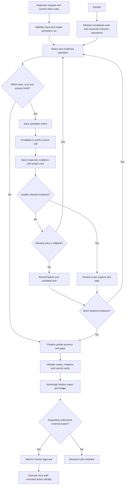

# Idea C: problem-statement audit and event output contract

**Latest clarification:** preserve comprehensive evidence investigation and deepen material gaps adaptively. The cuts below refer to mandatory quotas, presentation and unrelated features, not removal of customer/professional corroboration. See [build/START_HERE.md](build/START_HERE.md) for the selected LangGraph implementation sequence.

Reviewed 2026-11-22 against all four pages of [ContextCon05_BITS_Problem_Statement.pdf](C:/Users/goyal/Downloads/ContextCon05_BITS_Problem_Statement.pdf). The PDF is reference material supplied by the user, not authorization to deploy, contact counterparties, submit a track or execute payments. The user's selected idea remains Technical Vendor Evidence Review.

## Overall fit

Idea C fits the Research and markets track's precise, sourced research-answer job (page 1), subject to compatibility with the actual released client request and input/output formats. A completed bounded research assignment can be the whole paid service. The PDF does not require every service to clear a vendor, book a meeting or perform a business-system write; those are examples across different tracks.

Do not represent this as the Trust and compliance example unless the service actually establishes the legal identity/director facts that request requires. Do not claim Investing-track fit by substituting a VC client for the fixed fictional Indian 3PL. Organizers control hidden tests and request formats; our own schema cannot establish eligibility.

## Cut or defer

| Existing scope | Change for the first event build | Reason |
| --- | --- | --- |
| Seven mandatory report sections on every run | Short machine-readable answers plus a generated evidence view | Hidden tests assess the requested finished result, not report length. |
| Always investigate three customers and six professionals | Keep caps as optional ceilings; default to question-driven retrieval | Unneeded sources consume limited build/run time and budget. |
| Broad website crawl and every claim discovered | Investigate supplied questions first; bound automatic discovery | Reduces irrelevant work and factual surface area. |
| Comprehensive pilot plan | One missing artifact/question/test per unresolved requirement; full plan only when requested | Keeps next steps actionable without substituting a plan for the requested answer. |
| Global technical/company trust score | Criterion-level answers and explicit limitations | Avoids false precision and unsupported clearance implications. |
| Extra voice, contact, recurring watches, multi-agent roles and outbound messages | Defer; research/report generation is the core job | Not required to complete this bounded research service; adds permissions and restart risks. |

## Modify the core output

The following is a proposed internal contract, **not the organizer's released schema and not a Crustdata response schema**. Build an adapter to the released format rather than replacing it.

| Component | Required behavior for this proposed service |
| --- | --- |
| Request identity | Stable run/request ID; exact questions; buyer/client context and applied requirement version |
| Subject resolution | Vendor domain/entity, product/SKU when known, and unresolved identity ambiguity |
| Answers | One answer for each requested question; supported scope and material caveats |
| Assessment status | Proposed internal labels: supported, partially supported, contradicted, cannot verify. Contradiction needs incompatible evidence about the same scope/time. Match organizer vocabulary at the boundary. |
| Cannot verify | Explicit phrase, missing evidence, attempted source coverage and relevant retrieval/access failure; do not equate source failure with no evidence existing |
| Evidence | Source URL or saved API response reference, exact passage or JSON field locator/value, source publisher, record/event date and retrieval date; distinguish refresh/update dates |
| Customer support, when relevant | Claimed relationship, resolved entities, direct/intermediated role, relevant product/date and comparable versus unknown conditions |
| Professional support, when relevant | Public professional association/project statement, its source/date, and self-reporting/timeline limitations |
| Next step | Short question, requested artifact or proposed test tied to the unresolved requirement; label our proposal rather than sourced fact |
| Execution result | Completed/partial/blocked as an internal run state, distinct from a factual answer of cannot verify; coverage, deadline and budget effects |
| Audit | Per-call status/charge, attempts, cache/retrieval provenance, elapsed time, cost components and approval state for any authorized external action |

An unknown source date stays unknown and reduces the evidentiary use of that record; do not fabricate dates. Preserve older useful context but do not use it to establish a recent event. The PDF says each hidden case uses a record or event after 1 September 2026 (page 2); it does not say every background source must be newer. A fresh retrieval or profile refresh does not make an old deployment a new event.

Separate exact source facts from our inferences and proposals. A source about a company is not sufficient support for a different fact about that company. Attribution is part of the fact: a vendor reports an improvement versus an independently measured improvement.

## Add the execution requirements

| PDF requirement | Concrete addition | Page |
| --- | --- | --- |
| Fixed fictional Indian 3PL; records/requests supplied at kickoff | Client configuration and request adapter; load supplied constraints, no invented client capacity or needs | 2–3 |
| At least one decision uses live real-world data | An actual run-time source retrieval must support a material answer; label caches and test mocks distinctly. A health check does not establish a decision. | 2 |
| Unseen requests and hidden hard cases | General request handling; duplicate/entity disambiguation; unresolved question path; do not hardcode FarEye/project44 results | 2–3 |
| Each fact has exact evidence and date | Fact/evidence ledger with passage/field-level locators and date semantics; output review gates | 2 |
| Time/cost limit and per-call logging | Controller-enforced budgets, pacing, bounded retries/fallbacks and partial-result behavior | 3 |
| Requirement change at hour 3 | Versioned client rules/output adapters; apply changed limits before starting another operation; reassess conclusions affected by a rule change | 3 |
| Stop/restart at screening and finals | Persist request state, operation intents/results, evidence and final-output version; reuse completed work; handle unknown in-flight outcomes explicitly | 3–4 |
| Actions happen once after restart | Stable artifact IDs and atomic finalization; no duplicate deliverables/authorized external sends. Reconcile ambiguous provider completion; checkpoints alone cannot guarantee no duplicate billable request. | 4 |
| Approval for irreversible actions | Default public research has no outbound action. If later authorized, a separate external-action stage must wait for approval and log execution state. Do not require permission for every research read. | 2, 4 |
| Organizer repository and commits throughout | Work in supplied repo when made available; commit meaningful increments. Existing local artifacts are not proof of this deliverable. | 3 |
| README with buyer, input, finished result, pass mark and sources | Replace probe-only README with service contract once implementation exists; accurately disclose unimplemented behavior | 3 |
| Diagram includes calls, approvals, retries, ledger | Expand product diagram into an execution diagram with these control paths explicitly drawn | 3 |
| Price in rupees and measured job cost | State a proposed INR service price separately from verified measured costs, conversion assumptions and unpriced components | 4 |

Finance must include model/search/provider costs, failures/retries and applicable infrastructure allocation. Grant credits can reduce event cash outlay but do not establish zero ongoing commercial cost. Confirm an authoritative effective credit price before converting to INR; do not infer it from a dashboard balance. Separate measured values, assumptions and unknowns. A proposed selling price is not validated willingness to pay.

The sample's per-source credits are not the full cost or timing of one autonomous customer job. Measure a complete run, including recovery, rather than summing unrelated assistant-directed probes.

## Proposed first event slice

The external-action branch is conditional and outside the default research job. Its presence in the design does not authorize sending messages or imply that an action executor is implemented. Unknown in-flight provider outcomes require reconciliation or a transparent pause/partial result; the diagram does not create idempotency guarantees.

One vendor and a short request, for example two or three precise capability/customer questions. Resolve the subject, retrieve primary evidence, use one relevant customer reference or professional source if it can settle the question, and return compact cited answers with cannot verify where needed. Claim/customer/person limits remain configurable upper bounds, not a mandate to fill the report.

The optional customer and LinkedIn paths remain product features. The controller chooses them based on the evidence needed, and reports when budget or coverage prevents use. A case with no customer names must still finish usefully; it must not fabricate customers to satisfy a schema.

Research may legitimately conclude cannot verify. It should still attempt relevant available evidence within the limit and explain the unsettled fact. Returning cannot verify for every case is not a substitute for doing the research.

## Minimum meaningful checks before screening

1. A normal unseen vendor question with a directly supported answer using a recent relevant record/event.
2. An ambiguous vendor/customer name where evidence must not be attached to the wrong entity.
3. A copied testimonial or duplicate record that must not become multiple independent confirmations.
4. A feature/performance question that public sources cannot settle, returning cannot verify and naming what is missing.
5. A blocked/truncated/misdirected source, with fallback or a transparent coverage limitation.
6. A lower budget/new required output field applied without silently continuing under old rules.
7. Kill/restart after completed retrieval and near finalization: no lost evidence or duplicated finalized result; unknown in-flight charges are surfaced/reconciled.

These are our proposed acceptance checks, not the organizers' hidden test answers. Open-track teams must submit three cases with correct answers by 11:00 AM under the PDF (page 2); this applies only if choosing Open. Do not imply this deadline applies to every track or that we submitted anything.

## Demo and priorities

The PDF specifies a seven-hour build and hour-3 change, not the original twelve-hour ideation window. Finals allocate three minutes to demonstrate, including the kill, then five minutes for the live fix, two for questions and two for changeover (pages 3–4). Demonstrate request -> actual retrieval -> answer/evidence -> restart recovery -> final ledger. Expand research detail on demand.

Final weights: live run 20, robustness 15, design 15, ethics 25, finance 25 (page 4). Personal-data minimization, attributed claims and safe treatment of namesakes affect ethics; measured complete-run cost and an identifiable paying job affect finance. Novelty alone does not compensate for unsupported answers or an incomplete service.

## Readiness verdict

**Idea C is a plausible research-service fit; the current project is not screening-ready.** Existing artifacts demonstrate assistant-directed source research and a rejected small-model experiment. The released-format adapter, full autonomous controller, end-to-end run measurements, recovery checks, event repository deliverables and buyer/price validation are not established by those probes. Treat this file as the implementation acceptance register, not a claim that requirements have passed.
