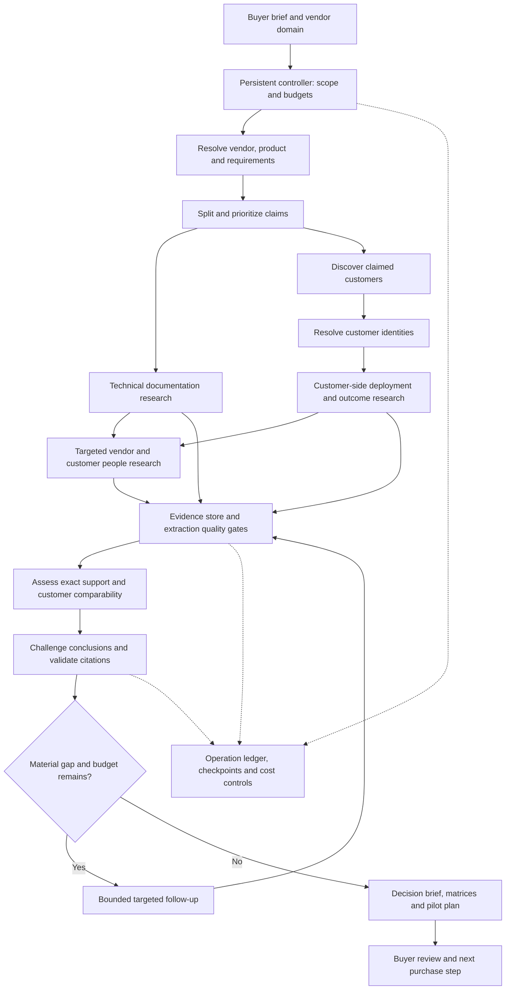

# Idea C — Technical Vendor Evidence Review

**Implementation handoff:** [build/START_HERE.md](build/START_HERE.md) is authoritative for the user's latest decisions: build with LangGraph, start with interactive API-enabled chat, preserve comprehensive evidence gathering with adaptive depth, and deliver the full dossier in later increments. Earlier event suggestions to reduce compulsory output sections do not authorize weakening evidence research.

Refined specification: **2026-11-22**. This is the current product/workflow proposal. It supersedes earlier suggestions to switch to sales qualification or make legal vendor verification the core. Those remain alternatives, not the selected idea. This document describes the intended system, not an already implemented autonomous service.

**Event audit:** [IDEA_C_EVENT_REQUIREMENTS.md](IDEA_C_EVENT_REQUIREMENTS.md) maps the four-page problem statement to required output and execution changes. For the event build, its compact, question-driven output and acceptance requirements take precedence over the broader report layout below. The actual organizer-released input/output format takes precedence over our proposed internal schema.

## Final idea statement

**An AI research agent that assesses a software vendor against a buyer's requirements, investigates its technical claims and publicly identified customer deployments, and delivers a sourced preliminary assessment plus the questions and pilot tests needed before purchase.**

Buyer-facing promise: **Know what the evidence supports, which customer references are relevant, and what still needs to be demonstrated before committing to a vendor.**

## Problem, buyer and paid job

The proposed buyer is a procurement, operations or technical leader evaluating logistics software. For the ContextCon scenario, it serves the fictional Indian 3PL. The buyer has specific requirements but must reconcile vendor marketing, API documentation, employee accounts, customer stories and supplier disclosures before arranging a useful technical meeting or pilot.

The proposed paid job is a bounded preliminary vendor assessment: investigate up to five requirements/claims, examine a small number of customer references, identify material integration constraints, and supply a decision brief and acceptance plan. The buyer receives completed research work, not just links or an open-ended chat. This could replace a defined preliminary analyst assignment; it does not establish replacement of a full diligence firm.

The service does not promise full technical due diligence, proprietary-IP verification, security/legal clearance, fraud detection or production purchase approval. These boundaries reflect the evidence available. Buyer acceptance, willingness to pay and full job economics remain unvalidated.

## Input and finished output

Required: vendor domain/name, buyer's intended use case and must-have requirements. Request product/SKU, geography, deployment constraints, integrations and comparison criteria where relevant. Optional: proposal/pitch material, supplied claims, named customer references and buyer-provided documents. If requirements are missing, label the result as exploratory research; do not generate a confident fit recommendation.

Every run has explicit time, provider-credit and model/service cost limits. All fields and statuses described below are proposed internal application records, not Crustdata API schemas.

Finished report:

1. A decision brief: supported requirements, unresolved must-haves, material constraints and a conditional next step.
2. A claim matrix: exact claim, source, evidence, supported scope, limitations and assessment.
3. A customer-evidence matrix: publicly claimed customer, resolved identity, relationship type, product/date, customer-origin evidence, outcome evidence and comparability.
4. Relevant professional evidence: role/project associations and statements, with provenance and employment timelines.
5. Prioritized supplier questions and requested artifacts, tied to unresolved decisions.
6. A pilot acceptance plan: test, expected behavior, measurement and buyer-defined pass condition for each unresolved must-have.
7. Source/freshness ledger and actual cost/coverage limits.

Answer every requested question first, using explicit **cannot verify** when the available sources cannot settle it, and identify the missing evidence. Keep factual answers separate from run completion and research recommendations. Optional next-step labels: **proceed to a scoped pilot**, **clarify before a pilot**, or **available evidence does not establish a must-have**. These are preliminary research recommendations. If the input or coverage is insufficient, return an incomplete assessment rather than assigning an approval-like verdict.

## Refined workflow

### 1. Scope and resolve

Translate the buyer's brief into testable requirements. Resolve company/domain and current product/business boundaries. Distinguish brand, parent, subsidiary and contracting entity when sources permit. Use narrow company context rather than collecting unrelated funding/headcount data. Identity ambiguity blocks claims dependent on that identity; it need not block unrelated usable research.

### 2. Discover and split claims

Review the vendor's website, supplied proposal, relevant product pages and documentation. Separate compound statements: an API's existence, a feature's release, production adoption and a percentage improvement each require different evidence. Preserve original wording and date. Vendor-generated claims are not automatically the buyer's priorities.

### 3. Gather technical evidence

Search developer/API documentation, engineering articles, releases, status documentation, subprocessors and relevant technology-provider accounts. Extract only passages needed for the claim. Documented contracts establish specified interfaces/constraints, not observed successful execution. Supplier cases are commercially interested evidence and can be historical.

### 4. Discover customer references

Extract customer names and attributed statements from case studies, logos, testimonials, announcements and posts. This creates a **publicly claimed customer list**, not a verified or exhaustive list of paying buyers. Preserve the product, date, relationship wording and originating source. A partner, reseller, conference participant or downstream beneficiary is not automatically a direct customer.

### 5. Resolve and investigate customers

Use company identity resolution to match the correct customer domain/entity. Search the customer's own pages and original professional posts for deployment evidence. Company enrichment provides context; repeated vendor copy is not corroboration. Model relationships explicitly, including intermediaries, so a deployment through an integrator is not converted into a fabricated direct contract.

Assess separately: was a relationship described; what product/function was used; was it a pilot or production; when and where; what outcome was reported; and whether methodology is available. Historical support does not automatically establish a current contract or adoption of a later AI feature.

### 6. Target people by responsibility

Search relevant current/former employees on vendor and customer sides. Senior leadership can explain commitments and direction; engineering/product staff can supply implementation detail; implementation staff and customer operators can describe deployment experience. Seniority does not confer independent authority.

Find professional role descriptions and original posts tied to unresolved questions. Match post/project dates to employment timelines. Follow public artifacts referenced in posts when relevant and accessible. Preserve self-reporting, stale roles, blank descriptions and conflicting records. Do not infer actual buying involvement, availability or willingness to provide a reference from a job title.

### 7. Review support and comparability

For each requirement, identify the supported portion and missing portion. Check entity, product/version, geography, date, metric, cohort and intended use. Group copied or syndicated statements by originating claim. A customer-owned statement is more attributable than a logo wall but may still be joint marketing.

Use distinct evidence descriptions: vendor-reported, employee-reported, documented interface, historical customer-reported use, artifact-supported component, or observed test. These are evidence types, not a universal ranking: their usefulness depends on the question. Keep support, freshness, independence and buyer fit separate rather than inventing a single calibrated confidence score.

A contradiction requires incompatible facts about the same scope and time. Missing evidence is not disproof. Differing agent counts or metrics may reflect versions, definitions or cohorts. Report the clarification needed instead of alleging deception.

### 8. Close material gaps, then deliver

Run one bounded follow-up search when it could change a must-have assessment. Stop on deadline, budget or diminishing information. Link every unresolved must-have to a supplier question, requested artifact or pilot test. Show coverage limitations. No external messages, reference calls, account creation or operational vendor API tests occur as part of this research-only execution path.

## System architecture

Use one capable model inside a persisted state machine, with narrow tools and ordinary concurrent retrieval for independent pages. Functional stages are not separate autonomous agents. Run a fresh review pass over the evidence packet; this is a challenge step, not independent verification by another party. Neither a multi-agent framework nor a large context window is required to define the workflow.

The model plans queries, extracts structured claims, assesses support and writes the deliverable. Deterministic code owns schemas/allowlists, budgets, pacing, capture persistence, hashes, date/number checks, deduplication and quote/source validation. Tool adapters keep connector/REST contracts separate from internal records.

## Data adapters and access constraints

| Need | Crustdata contribution | Additional evidence |
| --- | --- | --- |
| Vendor/customer identity | Identify, selected company enrichment | Corporate/product pages; official records if the question requires legal identity |
| Relevant professionals | Indexed people search and selected enrichment | Public biographies and attributable project artifacts |
| Professional statements | Indexed social-post search | Original linked article/demo/customer material where accessible |
| Source discovery/retrieval | Web search and public HTML fetch | Disclosed public retrieval fallback and document extraction |
| Performance, security, runtime behavior | Context and leads only | Methodology, underlying reports and authorized tests supplied later |

Official contracts: [company identify](https://docs.crustdata.com/company-docs/identify/introduction.md), [company enrichment](https://docs.crustdata.com/company-docs/enrichment/reference.md), [people search](https://docs.crustdata.com/person-docs/search/reference), [person enrichment](https://docs.crustdata.com/person-docs/enrichment/reference.md), [social search](https://docs.crustdata.com/social-post-docs/indexed-search/reference), [web search](https://docs.crustdata.com/web-docs/search/reference.md), [web fetch](https://docs.crustdata.com/web-docs/fetch/introduction.md).

The 2026-11-22 checks showed indexed people/social access, with live professional-network retrieval, contact enrichment and batch person verification disabled. Recheck effective permissions before later implementation. A callable tool is not a grant for every field. No jobs, watches or contact lookups are required for this initial service. Use jobs only when a specific claim makes them relevant. [Permissions](https://docs.crustdata.com/general/permissions.md), [freshness](https://docs.crustdata.com/general/data-updates.md).

Crustdata provides a consistent research interface and cross-entity discovery. Its indispensability or exclusive data advantage has not been demonstrated. The service's proposed differentiation is buyer-specific assessment, customer comparability and a useful validation plan.

## Evidence and recovery controls

- Save requested/resolved URL, channel, publisher, title, content hash, exact passage/field, retrieval time and distinct publication/update/event/refresh dates. Unknown dates remain unknown.
- Reject truncated, irrelevant, login/challenge and navigation-only responses as support. HTTP 200 alone does not pass extraction. Allow one disclosed fallback; preserve conflicting source versions.
- Never treat snippets as reviewed full-page evidence, profile counts as a workforce census, marketing percentages as guaranteed ROI, or a customer mention as a contract.
- Check quote membership and source IDs, then review semantic entailment. Mechanical validation cannot establish truth or independence. Preserve original metric qualifiers such as pilot, regional, median and up to.
- Keep raw captures outside the model context. Supply bounded claim-specific passages, relationships and limitations. Retrieved text cannot change permissions or authorize actions.
- Persist operation intent and result, claim status and actual charges. Cache completed work under an explicit freshness policy. An interrupted call with unknown completion must be reconciled where possible; it cannot be blindly replayed with a promise of no duplicate billing.
- Separate provider credits, model/service costs and researcher time. Unpriced components remain unpriced, not zero. Stop when any applicable budget is exhausted and return a useful partial result.

## Initial scope, evidence and acceptance test

Broader product ceiling: one vendor, up to five buyer-prioritized claims, three publicly identified customer references and six unique relevant professionals, under configurable time/cost limits. For the seven-hour event build, begin with a short request of two or three questions; customer and professional research are conditional paths rather than mandatory sections. These are caps, not minimum quotas or a promise of adequate coverage. Reuse sources across claims and retrieve fewer records when they cannot change the outcome. Support organizer requests through the released format, rather than hardcoding this example size.

The existing [FarEye](../output/probes/fareye-20261122/REVIEWED_FINDINGS.md), [project44](../output/probes/project44-20261122/REVIEWED_FINDINGS.md) and [LinkedIn-data](../output/probes/trust-linkedin-20261122/REVIEWED_FINDINGS.md) probes support feasibility of parts of this workflow. They do not establish autonomous correctness, full-job runtime/cost or buyer acceptance. The small-model FarEye output was rejected; manually reviewed findings are separate. The customer/professional investigations remain assistant-directed captures.

Evaluate the complete workflow on an unseen vendor and an actual buyer brief. Include sparse sources, a wrong-entity customer match, a copied testimonial, a historical deployment for an older product, an inaccessible page and an unsettled requirement. Measure unsupported conclusions, relevant evidence found, origin/date mistakes, usability of questions/tests, completion time and full cost against a simple research baseline. A successful case should help a buyer avoid repeating the preliminary research and use the resulting meeting/pilot plan.

No fabricated citations, no transfer of customer outcomes to an unrelated deployment, and no approval-like recommendation when a must-have remains unsettled. Buyer acceptance and willingness to pay are the commercial validation gate; more profiles or longer reports do not substitute for them.
