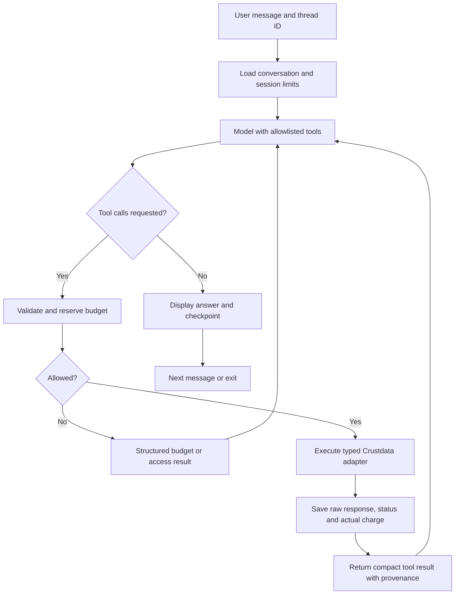

# LangGraph implementation architecture

**LangGraph is required by the user.** Proposed stack: Python, configurable tool-calling chat model, local CLI, typed Crustdata adapters and local persistence. Verify installed/current packages before choosing versions; no framework is installed by this handoff.

## Foundation graph — commit 01

One graph invocation handles a turn; a stable thread identifies a conversation across turns and process restarts. Persist messages and research/session metadata. Do not put credentials into graph state, tool traces or checkpoints.

The tool executor must enforce limits for every requested tool, including multiple calls in one model response. Do not expose an unrestricted HTTP/URL execution tool or let a model supply bearer tokens. Reserve estimated charge before dispatch; reconcile actual charge afterward. Unknown costs cannot be assumed zero.

## Product graph — later stages

Intake -> resolve -> prioritize claims -> baseline vendor/customer/professional discovery -> evidence acquisition/quality -> support and comparability review -> targeted follow-up -> final dossier. The foundation's model/tool loop supplies bounded research operations, not an unconstrained agent that owns its own limits.

## State and storage

Proposed state: messages; thread/run/turn IDs; buyer brief; vendor/product; requested questions; evidence references; remaining budgets/deadline; pending tool operations; unresolved gaps; final artifact IDs. The foundation needs only conversation, limits, operation references and source references initially.

Use a local durable checkpointer appropriate to current LangGraph APIs and a separate durable operation/evidence ledger (SQLite is a reasonable local choice). Checkpoints store graph progress; they are not a provider idempotency guarantee. A process killed after the provider completes but before capture leaves an unknown outcome. Record it and reconcile where supported; do not automatically reissue and claim exactly-once charging.

## Tool/data adapter boundary

The first implementation should prefer direct Crustdata REST behind validated typed tools, since the user wants a runnable app. Existing ChatGPT connector authorization is not automatically available to local code. If direct credentials are missing, report this precisely. An MCP integration is an alternative only after actual local authentication and schema access are established; do not pretend that imported function names give a local application connector access.

Verify official schemas, selected fields, pagination, actual permissions and costs. Keep internal evidence/ledger schemas separate. Capture provider request IDs/charge/rate metadata when exposed; redact secrets. No arbitrary generated JSON forwarder.

## Model configuration

Use an available capable model with structured tool calling, configured through environment/local settings. No provider or model has been chosen by the user. Inspect safely and ask for the missing provider configuration only if necessary. Do not hardcode the earlier Ollama 4B model. Credentials stay out of source, tests and commits.

## Budget and errors

Separate session/run limits from turn limits so conversation cannot reset spend allowance. Set finite tool-call, model-step, token and wall-time limits; allow the user to lower them. Account for model/service charges where known and mark unpriced amounts explicitly.

Handle permission/schema errors without blind retries; bound retryable failures and backoff; record truncation and extraction failure. A charged but unusable response remains charged. Respect actual effective rate limits. When access/budget is exhausted, explain and finish the turn usefully.

## Official implementation references

- [LangGraph overview](https://docs.langchain.com/oss/python/langgraph/overview)
- [Graph quickstart](https://docs.langchain.com/oss/python/langgraph/quickstart)
- [Persistence](https://docs.langchain.com/oss/python/langgraph/persistence)
- [Crustdata index](https://docs.crustdata.com/llms.txt)
- [Versioned API introduction](https://docs.crustdata.com/openapi-specs/2025-11-01/introduction.md)

Current LangGraph documentation describes graph-based state/control flow and checkpoint-backed thread persistence. Exact imports/checkpointer setup must be verified during implementation; this document intentionally does not invent framework signatures.
